# Diagramy systému

Návrhové diagramy podle `CLAUDE.md` a implementace (F0–F3). Jsou v [Mermaidu](https://mermaid.js.org/) — GitHub je vykreslí přímo, lokálně např. ve VS Code s rozšířením _Markdown Preview Mermaid Support_. Až dodáš vlastní flow diagramy, tyhle s nimi porovnáme a rozdíly dořešíme (viz [Otevřené otázky](#otevřené-otázky-k-ověření)).

Obsah:

1. [Architektura](#1-architektura)
2. [Datový model](#2-datový-model)
3. [Přihlášení magic linkem](#3-přihlášení-magic-linkem)
4. [Den závodu — celkový průběh](#4-den-závodu--celkový-průběh)
5. [Stav závodníka](#5-stav-závodníka)
6. [Checkpoint: tlačítko čísla](#6-checkpoint-tlačítko-čísla)
7. [Hromadný start kategorie](#7-hromadný-start-kategorie)
8. [Registrace na místě](#8-registrace-na-místě)
9. [Offline fronta a synchronizace](#9-offline-fronta-a-synchronizace)
10. [Stav akce ve frontě](#10-stav-akce-ve-frontě)
11. [Synchronizace hodin](#11-synchronizace-hodin)
12. [Dva organizátoři zapíšou stejného závodníka](#12-dva-organizátoři-zapíšou-stejného-závodníka)
13. [Výpočet výsledků](#13-výpočet-výsledků)
14. [Korekce admina a remíza](#14-korekce-admina-a-remíza)
15. [Checkpointy a sub-checkpointy](#15-checkpointy-a-sub-checkpointy)

---

## 1. Architektura

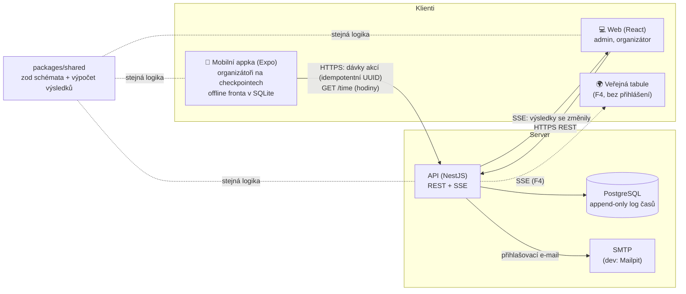

## 2. Datový model

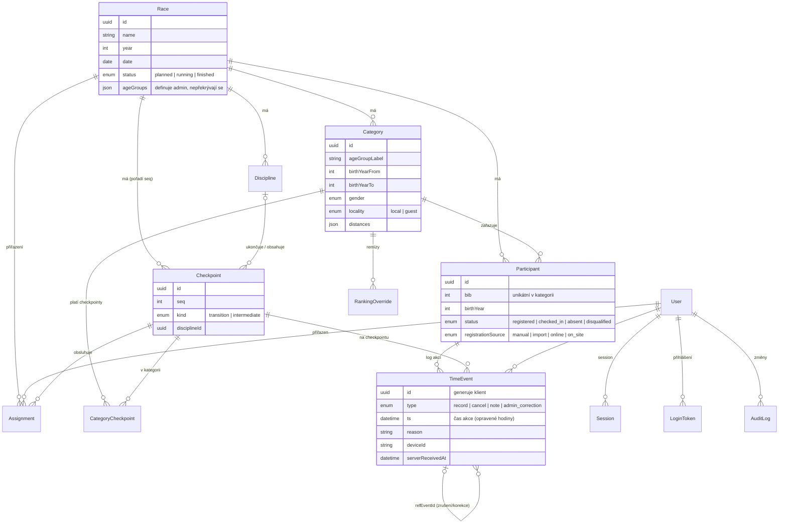

## 3. Přihlášení magic linkem

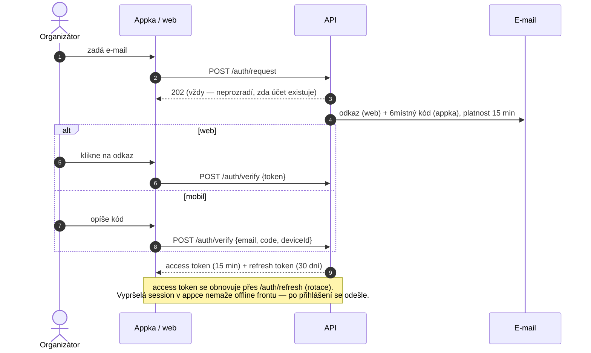

## 4. Den závodu — celkový průběh

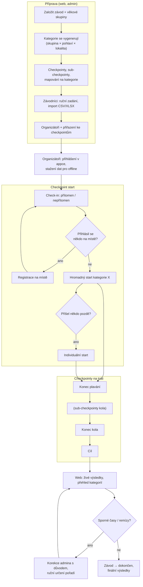

## 5. Stav závodníka

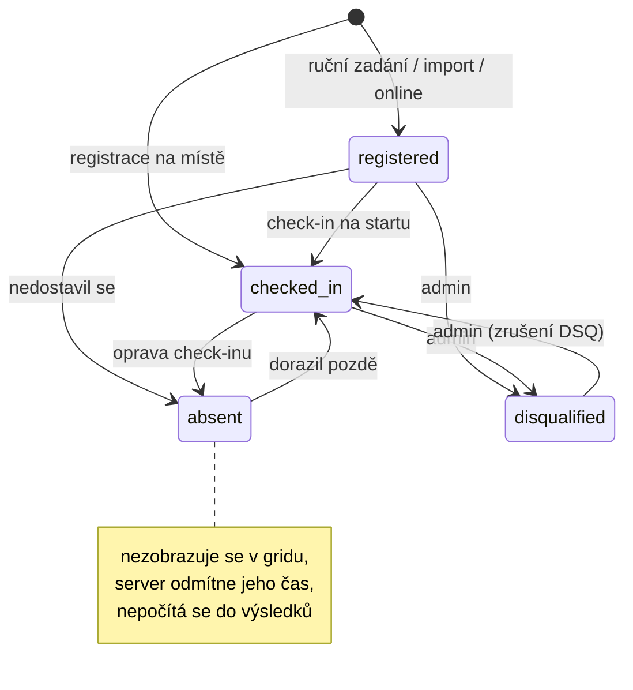

## 6. Checkpoint: tlačítko čísla

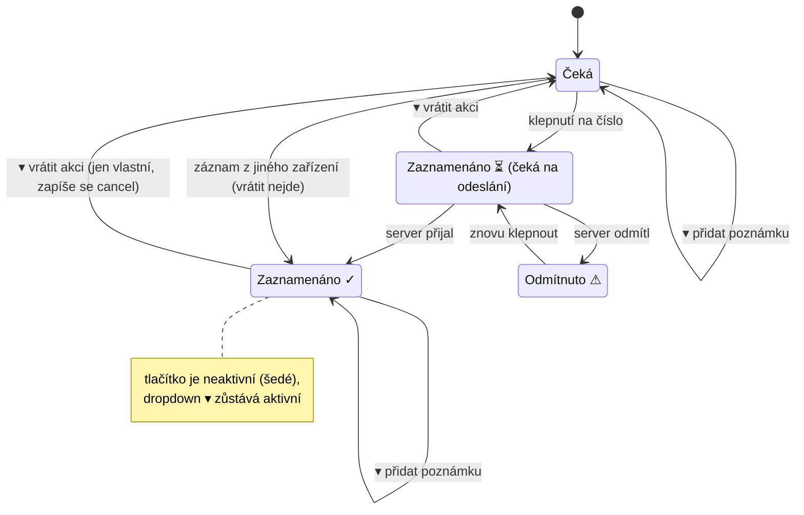

## 7. Hromadný start kategorie

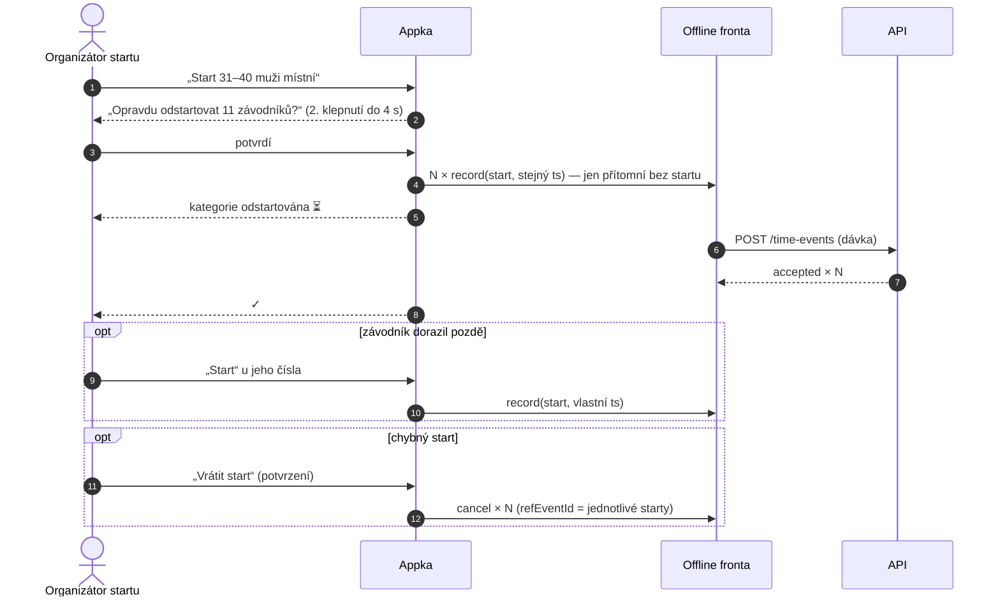

## 8. Registrace na místě

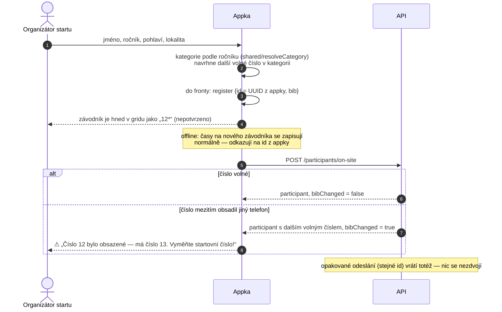

## 9. Offline fronta a synchronizace

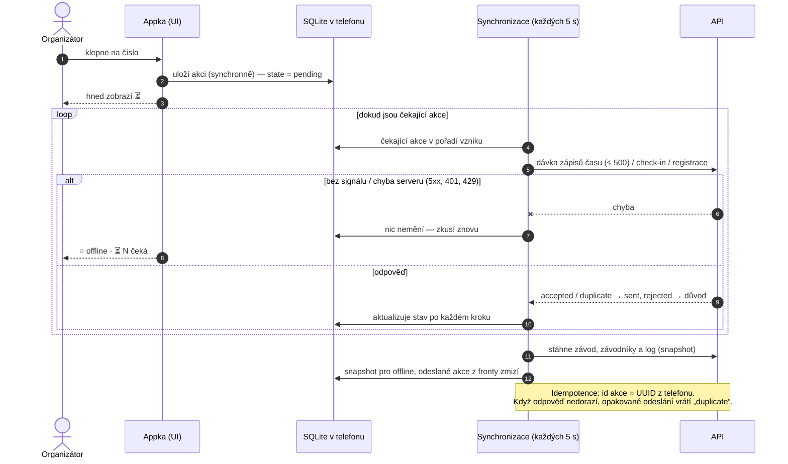

## 10. Stav akce ve frontě

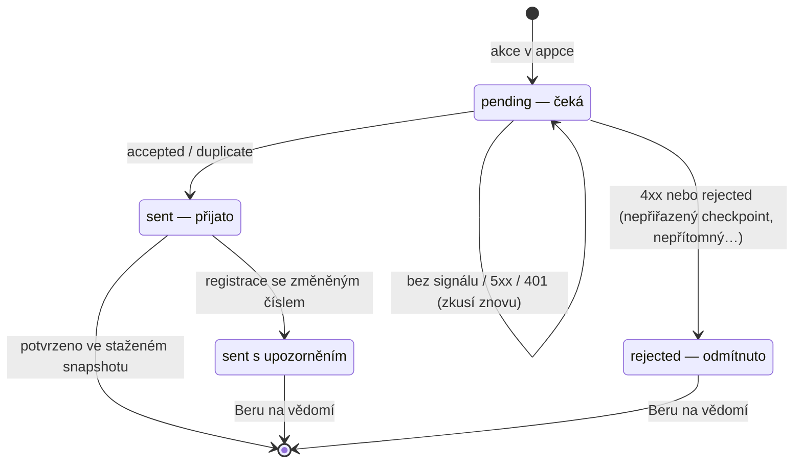

## 11. Synchronizace hodin

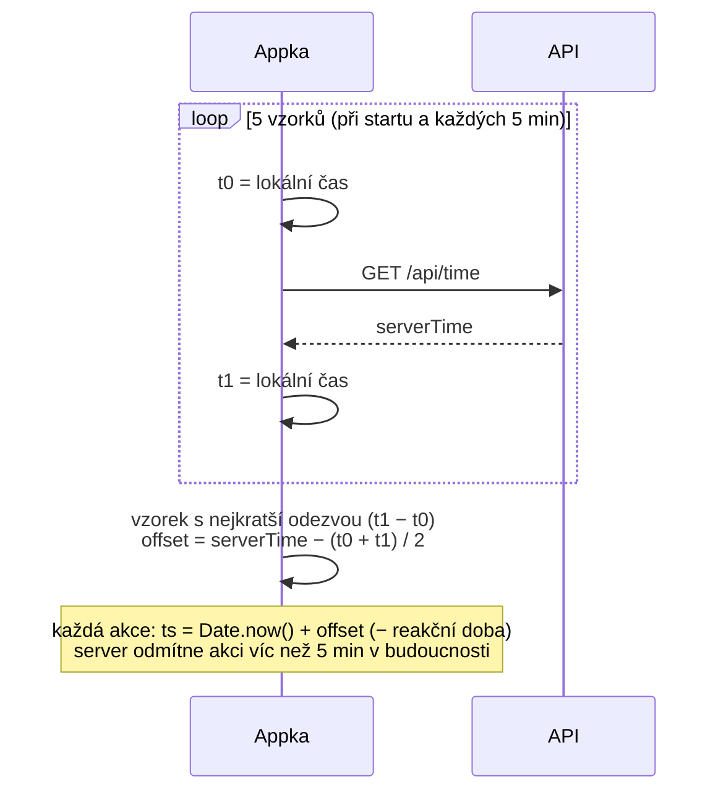

## 12. Dva organizátoři zapíšou stejného závodníka

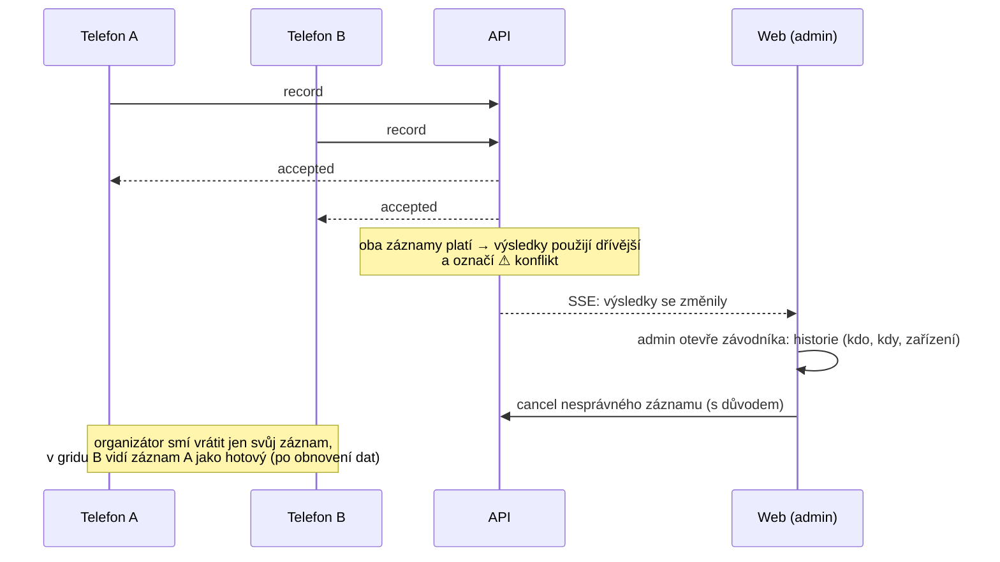

## 13. Výpočet výsledků

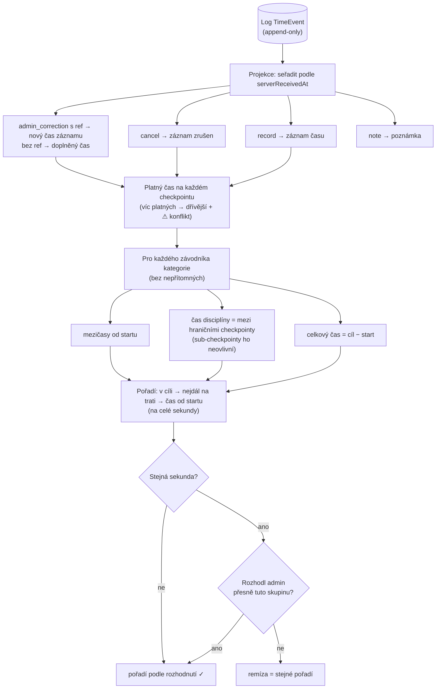

## 14. Korekce admina a remíza

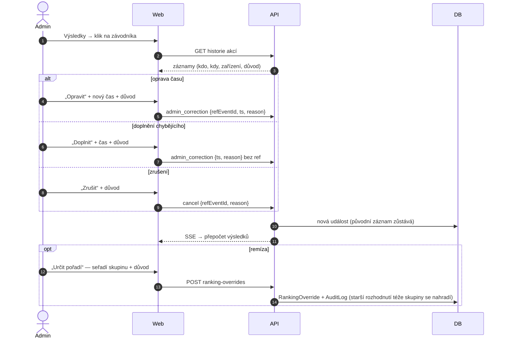

## 15. Checkpointy a sub-checkpointy

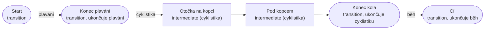

- Čas cyklistiky = Konec kola − Konec plavání; sub-checkpointy dávají jen mezičasy.
- Sub-checkpoint musí ležet mezi hranicí před disciplínou a hranicí, která ji ukončuje (API to hlídá i při přeřazení).
- Kategorie si volí, které checkpointy pro ni platí (např. děti bez otočky).

---

## Otevřené otázky k ověření

Tyto situace diagramy řeší výchozím chováním. Ověř je proti svým flow diagramům, až budou:

1. **Zápis mimo pořadí checkpointů** (např. cíl dřív než konec kola): appka ho povolí a výsledky použijí poslední dosažený checkpoint. Má appka varovat?
2. **Konflikt dvou záznamů**: platí dřívější a admin ho ověří. Nebo má mít přednost záznam od organizátora přiřazeného jako „hlavní“?
3. **Nepřítomný, který přece jen odstartuje**: organizátor startu ho přepne na přítomného a zapíše mu individuální start. Stačí to?
4. **Vrácení hromadného startu**: zruší všechny starty kategorie zapsané tímto organizátorem, včetně pozdních startů. Mají se pozdní starty zachovat?
5. **Reakční doba**: globální odečet 0–1 s na zařízení. Nebo radši korekce u konkrétního záznamu („−2 s“ v menu)?
6. **Odhlášení s neodeslanými akcemi**: appka varuje, akce zůstanou ve frontě a odešlou se po přihlášení téhož uživatele.
